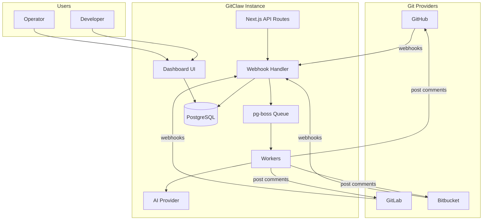
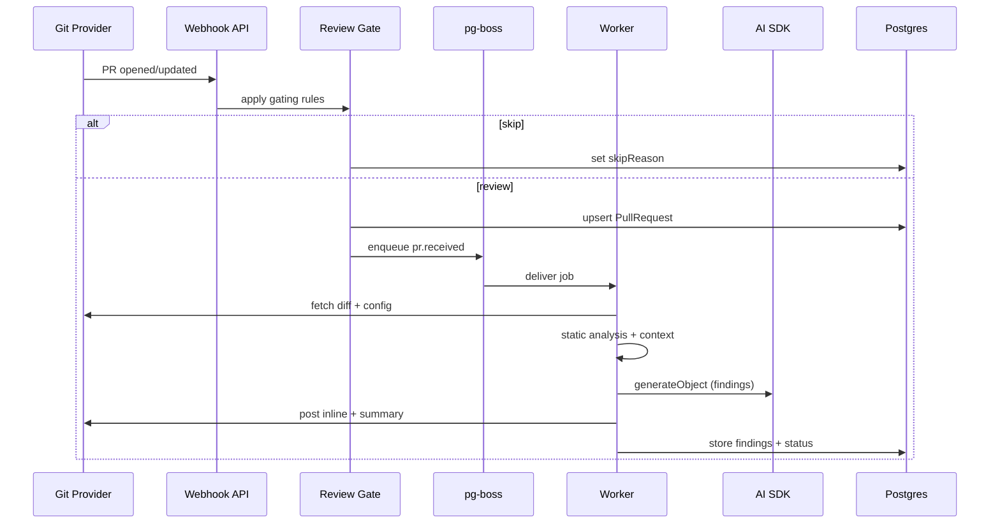

# GitClaw — Product & Technical Reference

> **Version:** 0.1.1 · **License:** MIT · **Repository:** [github.com/Abhivera/gitclaw](https://github.com/Abhivera/gitclaw) · **Website:** [gitclaw.online](https://gitclaw.online)

Single reference document covering product requirements, features, software architecture, packages/libraries, and deployable applications.

---

## Table of contents

1. [Product requirements (PRD)](#1-product-requirements-prd)
2. [Features](#2-features)
3. [Software architecture](#3-software-architecture)
4. [Packages & libraries](#4-packages--libraries)
5. [Applications & deployment](#5-applications--deployment)

---

## 1. Product requirements (PRD)

### 1.1 Problem statement

Engineering teams want automated, high-quality pull request review without sending source code to a third-party SaaS. Existing tools (e.g. CodeRabbit) are hosted services with usage limits and data residency concerns.

**GitClaw** is an open-source, self-hosted AI pull request reviewer that runs on the team's own infrastructure and posts review feedback directly inside GitHub, GitLab, and Bitbucket.

### 1.2 Product vision

> An AI reviewer that reads your diffs — not your code — running wherever you already run things.

- **Self-hosted:** Docker, manual install, npm package (`npx gitclaw-cli`), or native desktop app
- **Multi-provider:** GitHub App, GitLab OAuth, Bitbucket OAuth
- **Pluggable AI:** OpenRouter, Anthropic, Groq, or any OpenAI-compatible endpoint
- **No separate job orchestrator:** Postgres-backed queue (pg-boss) co-located with the app

### 1.3 Target users

| Persona | Goal | Primary path |
| --- | --- | --- |
| Solo developer | Quick local PR reviews | Desktop app or Docker |
| Engineering team | Org-wide automated review | Docker / VPS deployment |
| Security-conscious org | Keep diffs on owned infra | Self-hosted web + chosen AI provider |
| Open-source maintainer | Free, unlimited reviews | Docker or manual install |

### 1.4 Success criteria

| Metric | Definition |
| --- | --- |
| Review latency | PR webhook → first inline comment within minutes |
| Incremental reviews | Follow-up commits only re-review changed hunks |
| Provider coverage | GitHub, GitLab, Bitbucket with native comment APIs |
| Zero-config desktop | Install → configure `.env` → dashboard opens |
| Operator clarity | Dashboard shows PR status, findings, analytics |

### 1.5 Scope

**In scope (v0.1.x)**

- Automated PR review on open/update
- Inline + summary comments
- `@gitclaw` PR chat
- Auto-generated PR description (empty body on open)
- Per-repo `.gitclaw.yaml` configuration
- Dashboard: overview, repos, PRs, analytics, integrations, settings
- Desktop app (Windows, macOS, Linux) with embedded PostgreSQL
- Slack notification on review complete

**Out of scope / limitations**

- No multi-user login (single local instance user; auth tables were removed)
- Static analysis is **pattern-based regex**, not external ESLint/Semgrep/Gitleaks binaries
- "Teams" = one workspace + Slack webhook + per-repo toggles, not authenticated multi-tenant accounts

### 1.6 Key user flows

#### Flow A — Docker quick start

```
Clone repo → cp .env.example .env → docker compose up --build
→ Open localhost:3000 → Dashboard → Integrations → Connect provider
```

#### Flow B — PR review (core loop)

```
Provider webhook → verify + gate → upsert PullRequest → enqueue pr.received
→ worker fetches diff → static analysis + repo context → AI review
→ post inline/summary comments → update DB → optional Slack notify
```

#### Flow C — PR chat

```
Comment with @gitclaw → parse comment event → enqueue pr.chat-received
→ AI generates reply in context → post comment on PR
```

#### Flow D — Desktop first launch

```
Install native app → embedded Postgres starts → Next.js standalone serves UI
→ File → Open configuration folder → edit .env → restart
→ tunnel for webhooks (ngrok / cloudflared) → set APP_URL + ALLOWED_DEV_ORIGINS
```

#### Flow E — Configure via dashboard (desktop)

```
/dashboard/setup (wizard) or /dashboard/settings/configuration (full form)
→ PUT /api/desktop/config → writes user-data .env → server reloads
```

---

## 2. Features

### 2.1 Git provider integrations

| Feature | Description |
| --- | --- |
| GitHub App | Install via dashboard; webhook at `/api/github/webhook` |
| GitLab OAuth | Per-connection webhook at `/api/gitlab/webhook/[connectionId]` |
| Bitbucket OAuth | Per-connection webhook at `/api/bitbucket/webhook/[connectionId]` |
| Repository sync | Repos discovered from provider or PR events |
| Per-repo enable | Toggle reviews per repository in dashboard |

**Module:** `features/git-providers/`

### 2.2 Automated review

| Feature | Description |
| --- | --- |
| Webhook-driven | Reviews triggered on PR open and update |
| Review gating | Skips drafts, `[skip review]` titles, bot authors, duplicate SHAs, disabled repos |
| Incremental diffs | Re-reviews only changes since `lastReviewedSha` when enabled |
| Chunked AI calls | Splits diffs larger than ~48 KB into chunks |
| Structured output | Zod-validated findings: file, line, severity, body, suggestion |
| Inline comments | Posted on specific diff lines via provider API |
| Summary comment | Optional PR-level summary |
| Commit status | Sets pending/success/failure on head commit (GitHub) |
| Manual rerun | Dashboard action re-enqueues `pr.received` |

**Module:** `features/reviews/`

### 2.3 Configuration

| Feature | Description |
| --- | --- |
| `.gitclaw.yaml` | Per-repo: ignore paths, tone, instructions, review toggles |
| Static analysis flags | Enable/disable pattern groups (eslint, semgrep, gitleaks, npm_audit) |
| Auto description | Generate PR body when empty on open |
| Environment variables | `APP_URL`, `DATABASE_URL`, provider keys, AI keys (`.env`) |
| Desktop config UI | Form-based editing without hand-editing `.env` |

**Modules:** `features/config/`, `features/setup/`

### 2.4 AI providers

| Provider | Env key(s) |
| --- | --- |
| OpenRouter | `OPENROUTER_API_KEY` |
| Anthropic (Claude) | `ANTHROPIC_API_KEY` |
| Groq | `GROQ_API_KEY` |
| OpenAI-compatible | `OPENAI_BASE_URL`, `OPENAI_API_KEY` (Ollama, LM Studio, etc.) |
| Model override | `GITCLAW_REVIEW_MODEL` |

Auto-detection when `AI_PROVIDER` is unset. Factory in `features/ai/`.

### 2.5 Dashboard

| Page | Route | Purpose |
| --- | --- | --- |
| Overview | `/dashboard` | Recent PRs, connection status, stats |
| Repositories | `/dashboard/repos` | Synced repos, enable/disable, config status |
| Pull requests | `/dashboard/pull-request` | PR list with status badges |
| PR detail | `/dashboard/pull-request/[id]` | Findings, summary, rerun |
| Analytics | `/dashboard/analytics` | Reviews/week, severity, top files |
| Integrations | `/dashboard/integrations` | Connect GitHub/GitLab/Bitbucket |
| Settings | `/dashboard/settings` | Workspace settings, Slack webhook |
| Configuration | `/dashboard/settings/configuration` | Desktop-only env form |
| Setup | `/dashboard/setup` | Desktop first-run wizard |

**Module:** `features/dashboard/`, `features/analytics/`

### 2.6 Background jobs

| Queue | Trigger | Handler |
| --- | --- | --- |
| `pr.received` | PR open/update webhook | `runReviewPullRequest` |
| `pr.chat-received` | `@gitclaw` comment | `runChatPullRequest` |
| `pr.auto-description` | PR open (empty body) | `runAutoDescriptionPullRequest` |

**Module:** `features/jobs/` · **Engine:** pg-boss (Postgres-backed)

### 2.7 Marketing & downloads

| Surface | Route | Purpose |
| --- | --- | --- |
| Landing page | `/` | Shown when instance is not configured |
| Quickstart | `/quickstart` | Install, configure, deploy guide |
| Download redirect | `/download/[platform]` | Redirect to latest installer |
| Hosted files | `/downloads/*` | Static installer binaries + `downloads.json` manifest |

**Module:** `features/marketing/`

### 2.8 Notifications

- **Slack:** Optional webhook URL on organization; fires on review complete
- **Module:** `features/notifications/`

---

## 3. Software architecture

### 3.1 System context



### 3.2 Layered architecture

```
┌─────────────────────────────────────────────────────────────┐
│  Presentation                                               │
│  app/ · features/dashboard · features/marketing · setup     │
├─────────────────────────────────────────────────────────────┤
│  API layer                                                  │
│  app/api/* → thin route handlers                            │
├─────────────────────────────────────────────────────────────┤
│  Domain / features                                          │
│  git-providers · reviews · jobs · config · analytics · ai   │
├─────────────────────────────────────────────────────────────┤
│  Infrastructure                                             │
│  lib/env · lib/db · lib/instance · instrumentation          │
├─────────────────────────────────────────────────────────────┤
│  Data & messaging                                           │
│  PostgreSQL (Prisma 7) · pg-boss                            │
└─────────────────────────────────────────────────────────────┘
```

### 3.3 Provider adapter pattern

All git hosts implement `GitProviderAdapter` (`features/git-providers/types.ts`):

| Method | Purpose |
| --- | --- |
| `verifyWebhook` | Validate signature / secret |
| `parsePullRequestEvent` | Normalize PR payload |
| `parseCommentEvent` | Detect `@gitclaw` mentions |
| `getPullRequestFiles` | Fetch diff hunks |
| `postReview` | Post inline + summary comments |
| `postPullRequestComment` | Post chat reply |
| `fetchGitclawConfig` | Read `.gitclaw.yaml` from repo |
| `setCommitStatus` | Update commit check status |
| `listRepositories` | Sync repos to database |

Implementations: `github/adapter.ts`, `gitlab/adapter.ts`, `bitbucket/adapter.ts`

### 3.4 Data model

```
User ──┬── OrganizationMember ── Organization ──┬── ProviderConnection ──┬── Repository
       │                                        │                          └── PullRequest
       │                                        └── slackWebhookUrl
       └── (single local user: id = "local")
```

| Model | Key fields |
| --- | --- |
| `User` | `id`, `name`, `email` |
| `Organization` | `name`, `slug`, `slackWebhookUrl` |
| `ProviderConnection` | `provider`, `accessToken`, `webhookSecret`, `externalId` |
| `Repository` | `fullName`, `enabled`, `config` (cached `.gitclaw.yaml`) |
| `PullRequest` | `prNumber`, `headSha`, `status`, `reviewFindings`, `lastReviewedSha`, `skipReason` |

**Schema:** `prisma/schema.prisma`

### 3.5 Review processing pipeline



### 3.6 Worker bootstrap

`instrumentation.ts` starts pg-boss workers when:

- `NEXT_RUNTIME === "nodejs"`
- Not during `phase-production-build`
- Core env (`APP_URL`, `DATABASE_URL`) is configured

On desktop (`GITCLAW_DESKTOP=1`), worker failures do not crash the app.

### 3.7 Project structure

```
gitclaw/
├── app/                          # Next.js App Router
│   ├── api/                      # Webhook, OAuth, desktop config APIs
│   ├── dashboard/                # Authenticated dashboard pages
│   ├── download/[platform]/      # Installer redirect routes
│   ├── quickstart/               # Marketing quickstart
│   └── page.tsx                  # Landing (unconfigured) or redirect
├── cli/                          # gitclaw-cli npm package
│   ├── bin/gitclaw.mjs           # CLI entry (start, init, migrate, doctor)
│   ├── lib/                      # Bundle extraction, server launcher, embedded DB
│   └── scripts/                  # standalone.tgz packaging
├── components/ui/                # shadcn/ui components
├── desktop/                      # Electron main process
│   ├── main.mjs                  # Window, tray, menus
│   ├── server.mjs                # Embedded Postgres + Next standalone
│   └── scripts/                  # Icon, standalone, download prep
├── features/
│   ├── ai/                       # AI provider factory
│   ├── analytics/                # Dashboard charts
│   ├── config/                   # .gitclaw.yaml parse/load
│   ├── dashboard/                # Shell, nav, queries, actions
│   ├── git-providers/            # Adapters, webhooks, OAuth
│   ├── jobs/                     # pg-boss queue + workers
│   ├── marketing/                # Landing, downloads
│   ├── notifications/            # Slack
│   ├── organizations/            # Workspace bootstrap
│   ├── repositories/             # Repo sync
│   ├── reviews/                  # Review, chat, auto-description
│   ├── setup/                    # Desktop wizard + config form
│   └── static-analysis/          # Pattern-based pre-AI checks
├── lib/                          # env, db, instance, brand, utils
├── prisma/                       # Schema + migrations
├── public/downloads/             # Website-hosted installers + manifest
├── docker-compose.yml
├── Dockerfile
└── instrumentation.ts            # Worker startup hook
```

### 3.8 Tech stack summary

| Layer | Technology |
| --- | --- |
| Framework | Next.js 16.2.9 (App Router, Turbopack) |
| UI | React 19.2.4, Tailwind CSS v4, shadcn/ui, Base UI |
| Language | TypeScript 5 |
| Database | PostgreSQL 17, Prisma 7.8 (`@prisma/adapter-pg`) |
| Jobs | pg-boss 12 |
| Git APIs | Octokit 5 (GitHub), custom GitLab/Bitbucket clients |
| AI | Vercel AI SDK 6, Zod 4 structured output |
| Desktop | Electron 34, embedded-postgres 17, electron-builder 25 |
| Charts | Recharts 3 |
| Icons | Phosphor Icons |

---

## 4. Packages & libraries

### 4.1 Root package (`gitclaw@0.1.1`)

#### Runtime dependencies

| Package | Version | Role |
| --- | --- | --- |
| `next` | 16.2.9 | App framework, SSR, API routes |
| `react`, `react-dom` | 19.2.4 | UI rendering |
| `@prisma/client` | 7.8 | Database ORM client |
| `@prisma/adapter-pg` | 7.8 | Prisma 7 Postgres driver adapter |
| `pg` | 8.21 | Underlying Postgres driver |
| `pg-boss` | 12.19 | Postgres-backed job queue |
| `ai` | 6.0 | Vercel AI SDK (`generateObject`) |
| `@ai-sdk/anthropic` | 3.0 | Claude provider |
| `@openrouter/ai-sdk-provider` | 2.9 | OpenRouter provider |
| `@ai-sdk/openai-compatible` | 2.0 | Groq, Ollama, OpenAI-compatible |
| `octokit` | 5.0 | GitHub App auth + REST API |
| `zod` | 4.4 | Env validation, review schema, config schema |
| `yaml` | 2.9 | Parse `.gitclaw.yaml` |
| `minimatch` | 10.2 | Glob matching for ignore paths |
| `date-fns` | 4.4 | Date formatting in dashboard |
| `recharts` | 3.8 | Analytics charts |
| `@base-ui/react` | 1.5 | Headless UI primitives (shadcn) |
| `@phosphor-icons/react` | 2.1 | Icon set |
| `class-variance-authority` | 0.7 | Component variant utilities |
| `clsx` | 2.1 | Conditional class names |
| `tailwind-merge` | 3.6 | Merge Tailwind classes |
| `next-themes` | 0.4 | Dark/light theme (default: dark) |
| `tw-animate-css` | 1.4 | CSS animation utilities |
| `dotenv` | 17.4 | Environment file loading |

#### Dev dependencies

| Package | Role |
| --- | --- |
| `prisma` | Schema migrations, client generation |
| `typescript` | Type checking |
| `eslint`, `eslint-config-next` | Linting |
| `tailwindcss`, `@tailwindcss/postcss` | Tailwind v4 build |
| `shadcn` | UI component CLI + styles |
| `sharp` | Desktop icon generation |
| `cross-env` | Cross-platform env vars in build scripts |
| `@types/*` | TypeScript definitions |

#### NPM scripts

| Script | Description |
| --- | --- |
| `npm run dev` | Next.js dev server + workers |
| `npm run build` | Production build |
| `npm run start` | Production server |
| `npm run lint` | ESLint |
| `npm run typecheck` | `tsc --noEmit` |
| `npm run db:migrate` | Prisma migrate dev |
| `npm run db:push` | Push schema without migration |
| `npm run db:studio` | Prisma Studio GUI |
| `npm run desktop:dev` | Build + run Electron app |
| `npm run desktop:dist` | Package installer (current OS) |
| `npm run desktop:dist:win\|mac\|linux` | Platform-specific installer |
| `npm run desktop:prepare-downloads` | Copy installers to `public/downloads/` |
| `npm run desktop:publish-downloads` | Build + prepare website downloads |

### 4.2 Desktop package (`gitclaw-desktop@0.1.1`)

Located in `desktop/package.json`. Bundles the Next.js standalone output as Electron `extraResources`.

| Package | Version | Role |
| --- | --- | --- |
| `electron` | 34.5 | Desktop shell (window, tray, IPC, menus) |
| `electron-builder` | 25.1 | Package `.exe`, `.dmg`, `.AppImage`, `.deb` |
| `embedded-postgres` | 17.10 | Bundled PostgreSQL (no Docker required) |

#### Installer artifacts

| Platform | Format | Output name |
| --- | --- | --- |
| Windows x64 | NSIS `.exe` | `GitClaw-Setup-{version}.exe` |
| macOS x64 | `.dmg` | `GitClaw-{version}-x64.dmg` |
| macOS arm64 | `.dmg` | `GitClaw-{version}-arm64.dmg` |
| Linux x64 | `.AppImage` | `GitClaw-{version}-x64.AppImage` |
| Linux x64 | `.deb` | `GitClaw-{version}-x64.deb` |

Output directory: `release/desktop/`

### 4.3 CLI package (`gitclaw-cli`)

Located in `cli/`. Published to npm; runs the prebuilt Next.js standalone server from a single command (`npx gitclaw-cli start`).

| Package | Role |
| --- | --- |
| `tar` | Extract the bundled `standalone.tgz` on first run |
| `embedded-postgres` | Downloaded on demand into `~/.gitclaw/runtime` when `--embedded-db` is used (npm always strips nested `node_modules` from published packages, so the server bundle ships as a tarball) |

---

## 5. Applications & deployment

### 5.1 Web application

The primary deployable is a **Next.js 16** full-stack app serving both the dashboard UI and webhook API on a single port (default `3000`).

| Aspect | Detail |
| --- | --- |
| Entry | `npm run build && npm run start` |
| Dev | `npm run dev` |
| Workers | Co-located via `instrumentation.ts` (no separate process) |
| Config | `.env` (see `.env.example`) |
| Hosting | Docker, VPS, or Vercel (requires external Postgres) |

#### API routes

| Route | Method | Purpose |
| --- | --- | --- |
| `/api/github/webhook` | POST | GitHub App events |
| `/api/github/callback` | GET | GitHub App install callback |
| `/api/gitlab/callback` | GET | GitLab OAuth callback |
| `/api/gitlab/webhook/[connectionId]` | POST | GitLab project webhook |
| `/api/bitbucket/callback` | GET | Bitbucket OAuth callback |
| `/api/bitbucket/webhook/[connectionId]` | POST | Bitbucket PR webhook |
| `/api/desktop/config` | GET/PUT | Read/write desktop `.env` |
| `/api/dashboard/pull-requests/[id]/status` | GET | Poll PR review status |
| `/download/[platform]` | GET | Redirect to latest installer |

#### Behaviour notes

- `/` shows the marketing landing page when `APP_URL` + `DATABASE_URL` are unset; otherwise redirects to `/dashboard`
- `next.config.ts` enables `output: "standalone"` when `DESKTOP_BUILD=1` or `STANDALONE_BUILD=1`
- `pg-boss` is listed in `serverExternalPackages` to avoid bundling issues

### 5.2 Desktop application

Native Electron app for users who want GitClaw without Docker or a separate Postgres install.

| Component | File | Role |
| --- | --- | --- |
| Main process | `desktop/main.mjs` | Window, splash, tray, menus, IPC |
| Server | `desktop/server.mjs` | Start embedded Postgres, run migrations, spawn Next standalone |
| Preload | `desktop/preload.mjs` | Renderer bridge |
| Env | `desktop/env.mjs` | User-data directory paths |
| First run | `desktop/first-run.mjs` | Setup completion tracking |

#### Runtime ports (desktop)

| Service | Address |
| --- | --- |
| PostgreSQL | `127.0.0.1:15432` |
| Next.js | `127.0.0.1:13100` |

#### Desktop detection

`GITCLAW_DESKTOP=1` is set at runtime. Client code checks via `features/setup/lib/is-desktop.ts` to show setup wizard and configuration UI.

#### Build & distribute

```bash
# Development
npm run desktop:dev

# Package installer (current OS)
npm run desktop:dist

# Publish to website
npm run desktop:publish-downloads
```

CI builds all platforms on version tags via `.github/workflows/release-desktop.yml`.

### 5.3 Docker deployment

Recommended for production self-hosting.

**Files:** `Dockerfile`, `docker-compose.yml`, `docker-entrypoint.sh`

```bash
git clone https://github.com/Abhivera/gitclaw.git
cd gitclaw
cp .env.example .env
docker compose up --build
```

| Service | Image / build | Port | Notes |
| --- | --- | --- | --- |
| `postgres` | `postgres:17` | `5438→5432` | Persistent volume `postgres_data` |
| `app` | Built from `Dockerfile` | `3000` | Runs `prisma migrate deploy` then `next start` |

`DATABASE_URL` inside compose overrides `.env` to use the `postgres` service hostname.

**Dockerfile stages:** `deps` → `builder` (`npm run build`) → `runner` (production Node 22 slim)

### 5.4 Manual install (development)

```bash
git clone https://github.com/Abhivera/gitclaw.git && cd gitclaw
npm install
docker compose up -d postgres    # port 5438
cp .env.example .env             # fill in keys
npm run db:migrate
npm run dev                      # http://localhost:3000
```

### 5.5 npm package (`gitclaw-cli`)

Runs the prebuilt server without cloning the repo or using Docker.

```bash
npx gitclaw-cli start --embedded-db   # bundled PostgreSQL (downloaded on first use)
# or with your own database:
npx gitclaw-cli init                  # creates ~/.gitclaw/.env
npx gitclaw-cli start
```

| Aspect | Detail |
| --- | --- |
| Commands | `start`, `init`, `migrate`, `doctor` |
| Flags | `--port` (3000), `--host` (127.0.0.1), `--embedded-db`, `--db-port` (15433) |
| State | `~/.gitclaw` — `.env`, `app/<version>/` (extracted bundle), `postgres-data/`, `runtime/` (override with `GITCLAW_HOME`) |
| Runtime | Sets `GITCLAW_DESKTOP=1` + `GITCLAW_CONFIG_PATH`, so the setup wizard and dashboard configuration UI work; the server restarts when `.env` changes |
| Build | `npm run cli:build` — standalone Next build → `desktop/scripts/prepare-standalone.mjs` → `cli/standalone.tgz` (versions kept in lockstep with the root package) |
| Publish | `npm run cli:publish`, or CI on `v*` tags (`release-npm.yml`, requires `NPM_TOKEN` secret) |

### 5.6 Environment variables

| Category | Variables |
| --- | --- |
| **Core** | `APP_URL`, `DATABASE_URL` |
| **GitHub** | `GITHUB_APP_ID`, `GITHUB_APP_PRIVATE_KEY`, `GITHUB_WEBHOOK_SECRET`, `GITHUB_APP_SLUG` |
| **GitLab** | `GITLAB_CLIENT_ID`, `GITLAB_CLIENT_SECRET`, `GITLAB_BASE_URL` (optional) |
| **Bitbucket** | `BITBUCKET_CLIENT_ID`, `BITBUCKET_CLIENT_SECRET` |
| **AI** | `AI_PROVIDER`, `OPENROUTER_API_KEY`, `ANTHROPIC_API_KEY`, `GROQ_API_KEY`, `OPENAI_BASE_URL`, `OPENAI_API_KEY`, `GITCLAW_REVIEW_MODEL` |
| **Dev / desktop** | `ALLOWED_DEV_ORIGINS`, `DOWNLOAD_BASE_URL` |

Validated in `lib/env.ts`. Template in `.env.example`.

### 5.7 Deployment comparison

| Mode | Best for | Postgres | Public URL needed |
| --- | --- | --- | --- |
| **Docker Compose** | Production team server | Container (bundled) | Yes (for webhooks) |
| **Manual + dev Postgres** | Local development | Docker sidecar | Tunnel for webhooks |
| **npm (`npx gitclaw-cli`)** | Quick start without cloning | Own instance or `--embedded-db` | Tunnel for webhooks |
| **Desktop app** | Individual developer machine | Embedded (bundled) | Tunnel for webhooks |
| **Vercel + external DB** | Marketing + light usage | External provider | Yes |

---

## Appendix A — PR status values

| Status | Meaning |
| --- | --- |
| `pending` | Awaiting review |
| `processing` | Worker is running |
| `reviewed` | Review posted successfully |
| `skipped` | Gated out (see `skipReason`) |
| `failed` | Review errored |

**Skip reasons:** `draft`, `skip_review_title`, `duplicate_sha`, `bot_author`, `repo_disabled`, `reviews_disabled`

## Appendix B — `.gitclaw.yaml` reference

```yaml
version: 1
reviews:
  enabled: true
  incremental: true
  post_summary: true
  post_inline: true
ignore:
  - "dist/**"
  - "*.lock"
instructions: "Focus on security and performance."
tone: concise          # concise | detailed | mentoring
language_focus:
  - typescript
static_analysis:
  eslint: true         # pattern-based, not external ESLint
  semgrep: true
  gitleaks: true
  npm_audit: true
auto_description: true
```

**Schema:** `features/config/types/gitclaw-config.ts`

## Appendix C — CI & release

| Workflow | Trigger | Purpose |
| --- | --- | --- |
| `ci.yml` | Push/PR to `main` | Lint, typecheck, build |
| `release-desktop.yml` | Tag `v*` or manual | Build Windows/macOS/Linux installers, publish GitHub Release |
| `release-npm.yml` | Tag `v*` or manual | Build standalone bundle, publish `gitclaw-cli` to npm |

---

*This document reflects the implemented codebase at v0.1.1. Update it when adding features or changing architecture.*
